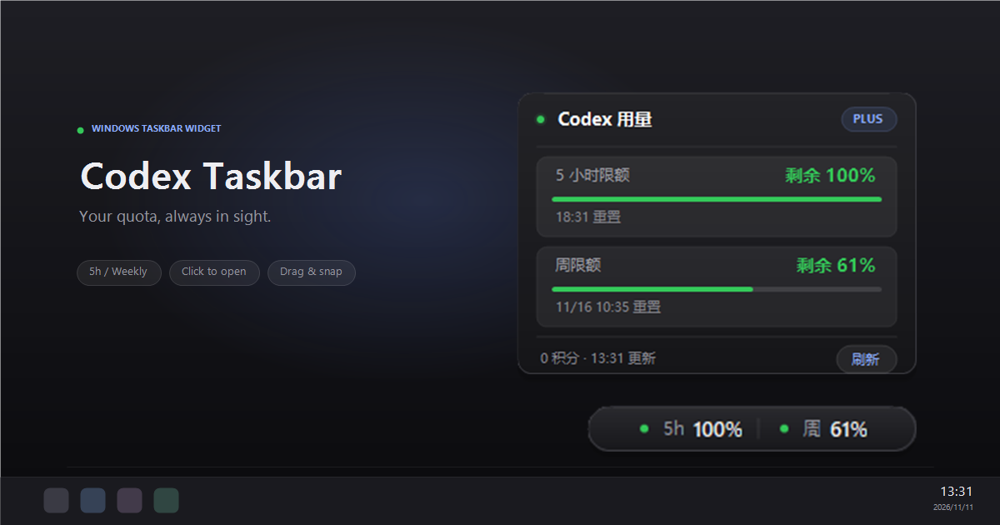
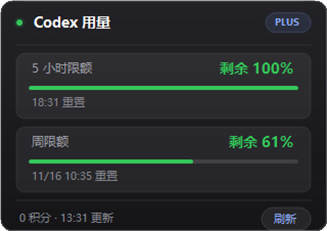

# Codex Tray Usage

English | [简体中文](README.md)

Show Codex quota information in the Windows notification area: the tray icon displays the remaining percentage for the 5-hour window, a small always-on-top pill shows both `5h / weekly` quotas, and clicking either one opens a dark usage panel inspired by macOS CodexBar.

<p align="center">
  
</p>

## Interface

| Usage panel | Status pill |
| :---: | :---: |
|  |  |

## Features

- Tray icon: a large number showing the remaining percentage of the 5-hour window, with a thin color-coded progress bar (green / orange / red)
- Status pill: a 198×28 gradient capsule with a status dot and `5h 81% · Week 64%`, highlighted on hover; **draggable** anywhere, snaps to screen edges on release, and remembers its position
- Compact usage panel (320×226): header with status dot and `PLUS` badge, two cards for the 5-hour and weekly limits (remaining percentage, full-width progress bar, reset time), credits and update time, and a refresh button; the panel opens above or below the pill automatically
- Refreshes every 60 seconds; the context menu supports manual refresh, showing/hiding the pill, launch at login, and exit
- Reuses the local Codex login (`~/.codex/auth.json`) and refreshes the token automatically when it expires

## Data source

- Credentials: `%USERPROFILE%\.codex\auth.json` (or the directory specified by `CODEX_HOME`)
- Usage endpoint: `GET https://chatgpt.com/backend-api/wham/usage`
- Percentages in the panel are "remaining" values = `100 - used_percent`; reset times come from the endpoint's `reset_at` and are converted to local time

## Build

.NET 10 SDK is required (only for building):

```powershell
cd D:\github\codex-taskbar
dotnet build -c Release
dotnet publish -c Release -r win-x64 --self-contained true -p:PublishSingleFile=true -o dist
```

This produces a single file: `dist\CodexTaskbar.exe` (self-contained, about 107 MB; no separate .NET runtime is needed on the target machine).

## Run

```powershell
D:\github\codex-taskbar\dist\CodexTaskbar.exe
```

On first launch the usage panel opens immediately, then the app stays in the notification area. To enable launch at login, tick the option in the tray context menu (writes to `HKCU\Software\Microsoft\Windows\CurrentVersion\Run`, no administrator rights required).

Command-line self-check (writes the current usage to JSON without opening the UI):

```powershell
D:\github\codex-taskbar\dist\CodexTaskbar.exe --check D:\github\codex-taskbar\usage-check.json
```

## Notes

- Windows does not allow third-party apps to insert text directly into the taskbar icon area. The notification area is the official equivalent, so the app combines a tray icon, a small always-on-top pill, and a popup panel.
- If Windows hides the tray icon in the `^` overflow area, drag it into the visible area to pin it.
- The status pill is a topmost floating window and occupies a small area above the taskbar. Untick "Show status pill" in the tray context menu when you do not need it.
- Drag the pill with the left mouse button; it snaps when released near a screen edge. Its position is stored in `settings.json`, and "Reset status pill position" in the tray context menu restores the default bottom-right position.
- Logs are written to `%APPDATA%\CodexTaskbar\app.log`, and settings to `%APPDATA%\CodexTaskbar\settings.json`.
- The app only reads existing local credentials. It does not upload or persist tokens.
- Only one instance is allowed; launching it again exits immediately.
