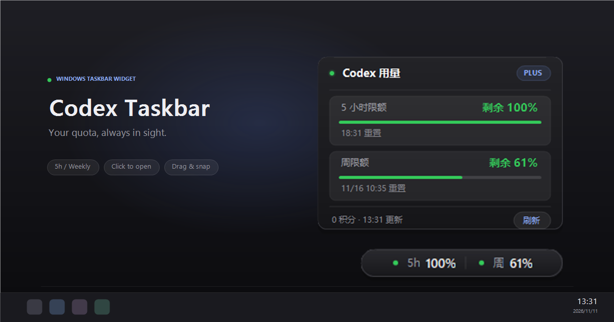
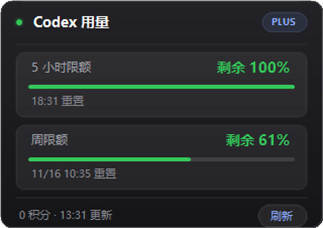
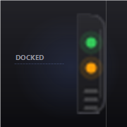

# Codex 托盘用量

[English](README.en.md) | 简体中文

把 Codex 的额度信息显示在 Windows 底部状态栏（通知区域）：托盘图标显示 5 小时剩余百分比，底部常驻小条显示 `5h / 周` 两项余量，点击任意一个都会弹出与 macOS CodexBar 同款的深色用量面板。

## 下载

[下载 Windows x64 版](https://github.com/suboy1219/codex-taskbar/releases/latest/download/CodexTaskbar.exe) · [所有版本](https://github.com/suboy1219/codex-taskbar/releases)

下载后直接运行 `CodexTaskbar.exe`，无需安装 .NET 运行时。使用前请先在本机登录 Codex。

<p align="center">
  
</p>

## 界面

| 用量面板 | 常驻状态条 | 贴边形态 |
| :---: | :---: | :---: |
|  |  |  |

## 功能

- 托盘图标：大号数字显示 5 小时窗口剩余百分比，底部细进度条按余量变色（绿 / 橙 / 红）
- 常驻状态条：160×24 渐变胶囊，状态点 + `5h 81% · 周 64%`，悬停高亮；**可拖动**到任意位置，拖到屏幕左/右边缘附近会缩成 14×48 贴边小条，拖出立即恢复完整胶囊，位置与贴边状态都会记住
- 点击弹出的紧凑用量面板（320×226）：标题栏（状态点 + `PLUS` 徽标）、5 小时 / 周限额两张卡片（剩余百分比 + 全宽进度条 + 重置时间）、积分与更新时间、刷新按钮；面板会自动跟随状态条位置展开
- 每 60 秒自动刷新；右键菜单可手动刷新、开关常驻条、开机自启、退出
- 直接复用本机 Codex 登录态（`~/.codex/auth.json`），token 过期时自动刷新

## 数据来源

- 登录凭证：`%USERPROFILE%\.codex\auth.json`（或 `CODEX_HOME` 指定的目录）
- 额度接口：`GET https://chatgpt.com/backend-api/wham/usage`
- 面板中的百分比为「剩余」= `100 - used_percent`；重置时间为接口 `reset_at` 转换成本地时间

## 构建

需要 .NET 10 SDK（仅构建时需要）：

```powershell
cd D:\github\codex-taskbar
dotnet build -c Release
dotnet publish -c Release -r win-x64 --self-contained true -p:PublishSingleFile=true -o dist
```

生成单文件：`dist\CodexTaskbar.exe`（自包含，约 107 MB，目标机器无需另装 .NET 运行时）。

## 运行

```powershell
D:\github\codex-taskbar\dist\CodexTaskbar.exe
```

首次启动会直接弹出用量面板，之后常驻托盘。开机自启可在托盘右键菜单里勾选（写入 `HKCU\Software\Microsoft\Windows\CurrentVersion\Run`，无需管理员权限）。

命令行自检（不打开界面，把当前额度写成 JSON）：

```powershell
D:\github\codex-taskbar\dist\CodexTaskbar.exe --check D:\github\codex-taskbar\usage-check.json
```

## 说明

- Windows 任务栏不允许第三方程序直接往图标区插入文字，系统托盘（通知区域）是官方等价位置，因此用「托盘图标 + 常驻小条 + 弹出面板」组合实现。
- 托盘图标若被 Windows 收进左侧的 `^` 溢出区，把它拖到可见区域即可固定显示。
- 常驻小条是置顶悬浮窗，会占用任务栏上方一小块区域；不需要时在托盘右键菜单取消勾选「显示常驻状态条」。
- 常驻小条可以直接用鼠标左键拖动；拖到屏幕左/右边缘附近会自动吸附并缩成贴边小条，从贴边小条向外拖动即可恢复完整胶囊。位置与贴边状态保存在 `settings.json`，托盘右键「重置状态条位置」可恢复默认的右下角。
- 日志位于 `%APPDATA%\CodexTaskbar\app.log`，设置位于 `%APPDATA%\CodexTaskbar\settings.json`。
- 程序只读取本机已有的登录凭证，不上传、不落盘保存 token。
- 同一时间只允许运行一个实例；重复启动会直接退出。
